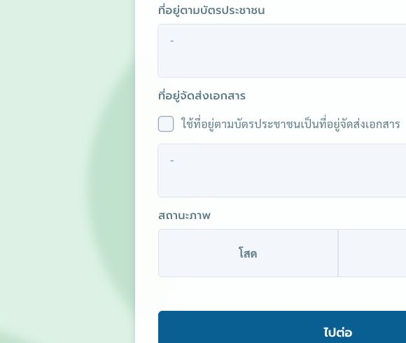
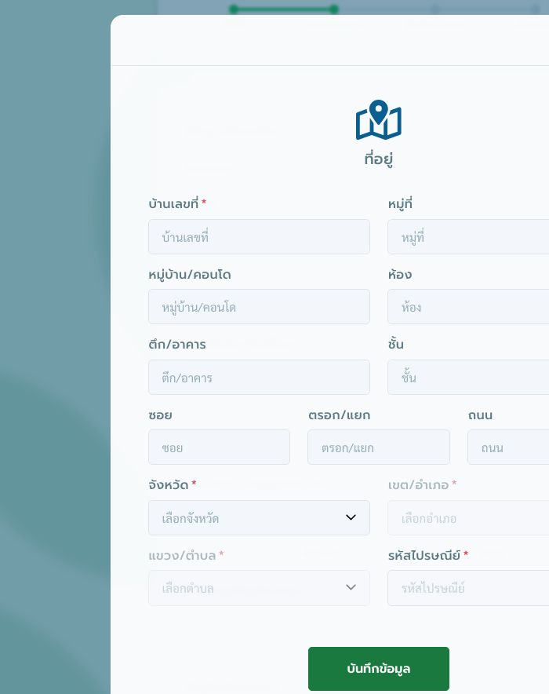
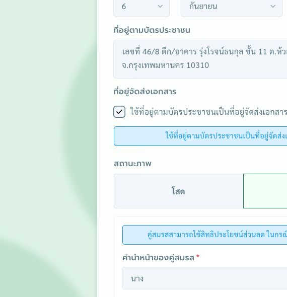
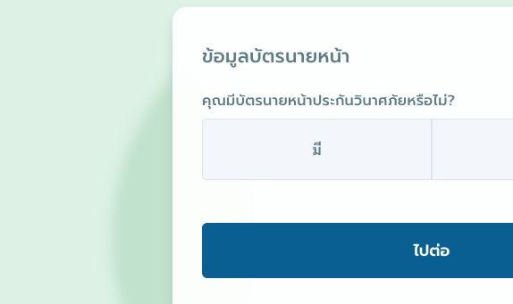
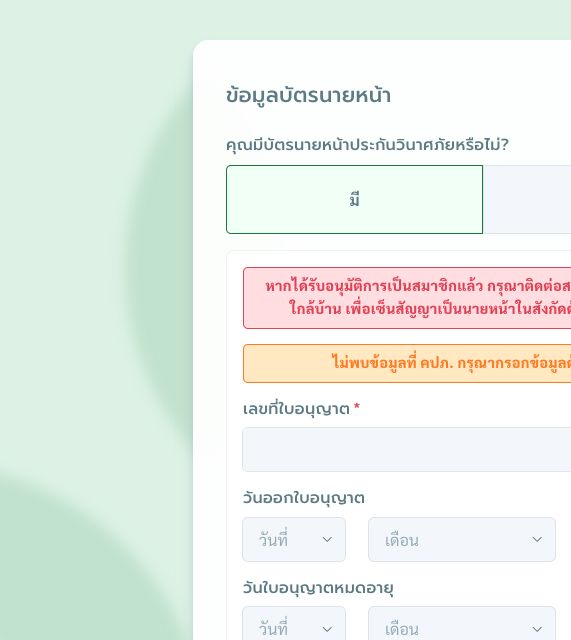
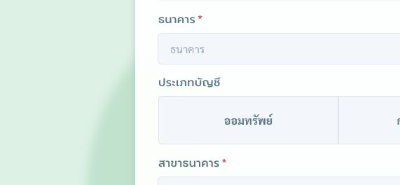
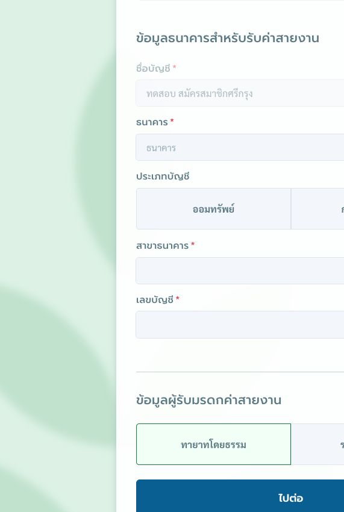

# คู่มือสมัครสมาชิกศรีกรุงโบรคเกอร์ — ฉบับรวมสำหรับตรวจร่าง

รวบรวมส่วนที่ 1–7 จากหน้าระบบที่ตรวจดูร่วมกัน ยังไม่ใช่คู่มือครบกระบวนการ และยังไม่ได้เผยแพร่ไปยัง GitHub

## สถานะการตรวจ

| ส่วน | บันทึกแล้ว | ยังต้องเก็บเพิ่ม |
| --- | --- | --- |
| 1 เริ่มต้นสมัคร | ข้อมูลผู้แนะนำ ช่องเลขบัตรประชาชน และภาพ | ผลตรวจเลขบัตร และหน้ากรอกข้อมูลเบื้องต้นก่อน OTP |
| 2 OTP | ข้อความหน้าจอ ปุ่มยืนยัน เวลานับถอยหลัง และผู้ใช้ยืนยันว่าไปหน้าข้อมูลส่วนตัวได้ | ภาพช่องรหัสว่าง จำนวนหลัก อายุรหัส และการขอรหัสใหม่ |
| 3 ข้อมูลส่วนตัว | ข้อมูลผู้สมัคร แบบฟอร์มที่อยู่ โสด/สมรส พร้อมภาพ | จุดเปิดฟอร์มที่อยู่ การเติมรหัสไปรษณีย์ ที่อยู่จัดส่งต่างจากบัตร และผลปุ่มไปต่อ |
| 4 บัตรนายหน้า | มี/ไม่มี กรณีไม่พบข้อมูล คปภ. ธนาคาร และผู้รับมรดกทั้งสองกรณี พร้อมภาพ | กรณีพบข้อมูล คปภ. กรณีเลือกไม่มี และผลปุ่มไปต่อ |
| 5 ข้อกำหนดและเงื่อนไข | รายการ 15 ข้อ ช่องยอมรับ ข้อความเตือน และปุ่มยืนยัน | ภาพประกอบและผลหลังยืนยัน |
| 6 ความยินยอมด้านข้อมูลส่วนบุคคล | ช่องความยินยอมและรับทราบ 4 รายการ ลิงก์นโยบาย และปุ่มยืนยัน | ข้อความเตือน รายการที่บังคับ ภาพประกอบ และผลหลังยืนยัน |
| 7 เพิ่มความคุ้มครอง PA | หมวดไม่มีค่ารักษาพยาบาล 7 แผน พร้อมราคาและวงเงิน | หมวดมีค่ารักษาพยาบาล สถานะแผนที่เลือก เงื่อนไขสิทธิ์ ภาพประกอบ และผลหลังเลือกแผน |

**ยังไม่จัดทำ:** ขั้นตอนยืนยันตัวตน E-KYC การชำระเงิน และการติดตามผล ต้องตรวจระบบต่อก่อนเรียบเรียง

หมายเหตุสำหรับผู้ตรวจร่างในแต่ละส่วนเป็นบันทึกการตรวจสอบ จะไม่นำไปเป็นคำแนะนำสำหรับผู้สมัครในฉบับเผยแพร่

---

# ส่วนที่ 1 เริ่มต้นสมัครสมาชิก

เปิดลิงก์สมัครสมาชิกศรีกรุงโบรคเกอร์ที่ได้รับจากผู้แนะนำ แล้วตรวจสอบข้อมูลผู้แนะนำก่อนกรอกเลขบัตรประชาชนของผู้สมัคร

## 1. เปิดลิงก์สมัครสมาชิก

เปิดลิงก์ที่ได้รับจากผู้แนะนำผ่านเว็บเบราว์เซอร์ ระบบจะแสดงหน้า **สมัครสมาชิกศรีกรุงโบรคเกอร์**

*ภาพประกอบ: หน้าเริ่มสมัครสมาชิกผ่านลิงก์ผู้แนะนำ — ตรวจสอบข้อมูลผู้แนะนำก่อนกรอกเลขบัตรประชาชน*

## 2. ตรวจสอบข้อมูลผู้แนะนำ

ที่หัวข้อ **ผู้แนะนำของท่าน** ตรวจสอบข้อมูลต่อไปนี้

- ชื่อและนามสกุลของผู้แนะนำ
- เลขที่ใบอนุญาตและวันที่หมดอายุ
- หมายเลขโทรศัพท์สำหรับติดต่อ

หากชื่อผู้แนะนำไม่ตรงกับผู้ที่แนะนำคุณ ให้ติดต่อผู้แนะนำเพื่อขอลิงก์ที่ถูกต้องก่อนดำเนินการต่อ

## 3. ตรวจสอบข้อมูลก่อนลงทะเบียนสมาชิก

1. ไปที่หัวข้อ **ตรวจสอบข้อมูลก่อนลงทะเบียนสมาชิก**
2. กรอกเลขบัตรประชาชน 13 หลักของผู้สมัครในช่อง **เลขบัตรประชาชน**
3. ตรวจทานเลขบัตรประชาชนให้ถูกต้อง แล้วกดปุ่ม **ตรวจสอบข้อมูล**
4. รอผลการตรวจสอบและดำเนินการตามข้อความที่ระบบแสดง

---

> **หมายเหตุสำหรับผู้ตรวจร่าง — ไม่ใช่เนื้อหาสำหรับเผยแพร่:** ตัวอย่างนี้ใช้ภาพหน้าจอจริงจากหน้าเริ่มสมัครผ่านลิงก์ผู้แนะนำ โดยเว้นช่องเลขบัตรประชาชนว่างไว้ ยังไม่ได้ตรวจผลหลังคลิกปุ่ม “ตรวจสอบข้อมูล” จึงยังไม่ระบุข้อความแจ้งเตือนหรือเงื่อนไขการผ่าน/ไม่ผ่าน

---

# ส่วนที่ 2 ยืนยันรหัส OTP

ระบบจะแสดงหน้า **ยืนยันด้วย OTP** พร้อมหมายเลขโทรศัพท์ปลายทางที่ปิดบังบางหลัก และ **รหัสอ้างอิง REFCODE**

1. ตรวจสอบหมายเลขโทรศัพท์ปลายทางที่ระบบแสดง
2. เปิดข้อความ OTP ที่ได้รับ และตรวจสอบรหัสอ้างอิงให้ตรงกับ **REFCODE** บนหน้าจอ
3. กรอกรหัส OTP ลงในช่องที่กำหนด ภายในเวลานับถอยหลังที่แสดงใต้ช่องกรอก
4. กด **ยืนยันรหัส OTP**
5. เมื่อยืนยันสำเร็จ ให้ดำเนินการต่อในส่วนที่ 3 กรอกข้อมูลส่วนตัว

หากระบบแสดงข้อความ **กรุณาใส่รหัส OTP** ให้ตรวจสอบว่ากรอกรหัสครบถ้วนก่อนยืนยันอีกครั้ง

---

> **หมายเหตุสำหรับผู้ตรวจร่าง — ไม่ใช่เนื้อหาสำหรับเผยแพร่:** ตรวจหน้าระบบจริงแล้ว พบเวลานับถอยหลังและปุ่มยืนยันตามข้อความข้างต้น ยังไม่ได้ตรวจจำนวนหลักของ OTP ระยะเวลาเริ่มต้น เงื่อนไขเมื่อขอรหัสใหม่ ผู้ใช้ยืนยันว่าทำรายการสำเร็จและเข้าสู่หน้ากรอกข้อมูลส่วนตัวแล้ว ภาพที่ตรวจดูมีการเริ่มกรอกรหัสอยู่ จึงยังไม่บันทึกภาพนั้นเป็นภาพประกอบคู่มือ ต้องเก็บภาพช่องว่างเพิ่มเติม

---

# ส่วนที่ 3 กรอกข้อมูลส่วนตัว

เมื่ออยู่ในขั้นตอน **กรอกข้อมูล** ให้ตรวจสอบและระบุข้อมูลในหัวข้อ **ข้อมูลส่วนตัว** ให้ถูกต้อง

## 1. ตรวจสอบชื่อผู้สมัคร

ตรวจสอบ **คำนำหน้า ชื่อ และนามสกุล** ที่ระบบแสดง หากต้องแก้ไข ให้เลือกคำนำหน้าหรือแก้ไขข้อความในช่องที่เกี่ยวข้อง โดยใช้ข้อมูลให้ตรงกับบัตรประชาชนของผู้สมัคร ช่องที่มีเครื่องหมาย **\*** เป็นข้อมูลที่ต้องระบุ

*ภาพประกอบ: หน้าข้อมูลส่วนตัว แสดงขั้นตอนปัจจุบันและช่องข้อมูลชื่อผู้สมัคร*

## 2. ตรวจสอบหมายเลขโทรศัพท์และระบุวันเกิด

1. ตรวจสอบ **หมายเลขโทรศัพท์** ที่ระบบแสดง ช่องนี้ไม่สามารถแก้ไขได้ในหน้าจอปัจจุบัน
2. ระบุ **อีเมล** ของผู้สมัคร
3. เลือก **วันเกิด** โดยแยกเป็นวันที่ เดือน และ **ปี พ.ศ.**

## 3. กรอกข้อมูลที่อยู่

เมื่อเปิดหน้าต่าง **ที่อยู่** ให้กรอกข้อมูลของที่อยู่ที่ต้องการระบุ โดยช่องที่มีเครื่องหมาย **\*** เป็นข้อมูลที่ต้องระบุ

1. กรอก **บ้านเลขที่**
2. กรอกรายละเอียดเพิ่มเติมตามที่อยู่ของผู้สมัคร ได้แก่ **หมู่ที่ หมู่บ้าน/คอนโด ห้อง ตึก/อาคาร ชั้น ซอย ตรอก/แยก และถนน**
3. เลือก **จังหวัด** จากนั้นเลือก **เขต/อำเภอ** และ **แขวง/ตำบล** ตามลำดับ
4. ตรวจสอบ **รหัสไปรษณีย์** ให้ตรงกับที่อยู่
5. ตรวจทานข้อมูลทั้งหมด แล้วกด **บันทึกข้อมูล**

*ภาพประกอบการกรอกที่อยู่ — ระบุข้อมูลให้ครบ โดยเฉพาะช่องที่มีเครื่องหมายดอกจัน แล้วกดบันทึกข้อมูล*

กลับมาตรวจสอบข้อมูลในหัวข้อ **ที่อยู่ตามบัตรประชาชน** และ **ที่อยู่จัดส่งเอกสาร** ให้ตรงกับที่ต้องการใช้

หากต้องการใช้ที่อยู่เดียวกัน ให้เลือก **ใช้ที่อยู่ตามบัตรประชาชนเป็นที่อยู่จัดส่งเอกสาร**

## 4. เลือกสถานภาพและดำเนินการต่อ

ที่หัวข้อ **สถานะภาพ** เลือกตัวเลือกให้ตรงกับข้อมูลของผู้สมัคร โดยแบ่งเป็น 2 กรณี

### กรณีโสด

เลือก **โสด** ระบบไม่แสดงช่องข้อมูลคู่สมรสเพิ่มเติม ตรวจสอบข้อมูลส่วนตัวให้ครบถ้วน แล้วกด **ไปต่อ** ที่ท้ายหัวข้อข้อมูลส่วนตัว

### กรณีสมรส

เมื่อเลือก **สมรส** ระบบจะแสดงช่องข้อมูลคู่สมรสเพิ่มเติม โดยต้องกรอกให้ครบทั้ง 3 ช่องที่มีเครื่องหมาย **\***

1. เลือก **คำนำหน้าของคู่สมรส**
2. กรอก **ชื่อของคู่สมรส**
3. กรอก **นามสกุลของคู่สมรส**

ตรวจสอบข้อมูลให้ถูกต้อง แล้วกด **ไปต่อ** ที่ท้ายหัวข้อข้อมูลส่วนตัว

> ระบบระบุว่า คู่สมรสสามารถใช้สิทธิประโยชน์ส่วนลดในกรณีนามสกุลเดียวกัน

*ภาพกรณีสมรส — แสดงข้อมูลคู่สมรสที่ต้องกรอก พร้อมข้อความเรื่องสิทธิประโยชน์ส่วนลดและปุ่มไปต่อ*

*ภาพประกอบ: ส่วนอีเมล วันเกิด ที่อยู่จัดส่งเอกสาร และสถานภาพ ก่อนกดไปต่อ*

---

> **หมายเหตุสำหรับผู้ตรวจร่าง — ไม่ใช่เนื้อหาสำหรับเผยแพร่:** บันทึกจากหน้าระบบที่เปิดอยู่ โดยไม่ได้เปลี่ยนข้อมูลหรือส่งแบบฟอร์ม เก็บภาพแบบฟอร์มที่อยู่ว่างและกรณีสมรสแล้ว พบว่าหน้าหลักแสดงที่อยู่ที่บันทึกและข้อความยืนยันการใช้ที่อยู่ตามบัตรประชาชนเป็นที่อยู่จัดส่งเอกสาร ยังต้องตรวจจุดที่กดเพื่อเปิดหน้าต่างที่อยู่ การเติมรหัสไปรษณีย์ กรณีที่อยู่จัดส่งต่างจากบัตรประชาชน และผลหลังคลิก “ไปต่อ” ก่อนจัดทำฉบับสมบูรณ์ ส่วน OTP มีร่างเนื้อหาแล้ว แต่ยังขาดภาพช่องกรอกรหัสว่าง

---

# ส่วนที่ 4 ข้อมูลบัตรนายหน้า

ในหัวข้อ **ข้อมูลบัตรนายหน้า** ระบบจะแสดงคำถาม **คุณมีบัตรนายหน้าประกันวินาศภัยหรือไม่?** ให้เลือกตามข้อมูลของผู้สมัคร โดยแบ่งเป็น 2 กรณี

*ภาพตัวเลือกข้อมูลบัตรนายหน้า ก่อนเลือกกรณีมีหรือไม่มีบัตรนายหน้าประกันวินาศภัย*

## กรณีมีบัตรนายหน้า

เลือก **มี** หากผู้สมัครมีบัตรนายหน้าประกันวินาศภัย

### 1. ข้อมูลใบอนุญาต

หากระบบแสดงข้อความ **ไม่พบข้อมูลที่ คปภ. กรุณากรอกข้อมูลด้วยตนเอง** ให้ระบุข้อมูลตามใบอนุญาตของผู้สมัคร ดังนี้

1. กรอก **เลขที่ใบอนุญาต** ซึ่งเป็นช่องที่มีเครื่องหมายดอกจัน
2. เลือก **วันออกใบอนุญาต** โดยระบุวันที่ เดือน และปี พ.ศ.
3. เลือก **วันใบอนุญาตหมดอายุ** โดยระบุวันที่ เดือน และปี พ.ศ.

ระบบแจ้งว่า เมื่อได้รับอนุมัติการเป็นสมาชิกแล้ว ให้ติดต่อสาขาศรีกรุงโบรคเกอร์ใกล้บ้าน เพื่อเซ็นสัญญาเป็นนายหน้าในสังกัดด้วยตนเองอีกครั้ง

*ภาพกรณีไม่พบข้อมูลที่ คปภ. — กรอกเลขที่ใบอนุญาต วันออกใบอนุญาต และวันหมดอายุ*

### 2. ข้อมูลธนาคารสำหรับรับค่าสายงาน

1. ตรวจสอบ **ชื่อบัญชี** ที่ระบบแสดง ช่องนี้ไม่สามารถแก้ไขได้ในหน้าปัจจุบัน
2. เลือก **ธนาคาร**
3. เลือก **ประเภทบัญชี** เป็น **ออมทรัพย์** หรือ **กระแสรายวัน**
4. กรอก **สาขาธนาคาร** และ **เลขบัญชี** ให้ถูกต้อง

### 3. ข้อมูลผู้รับมรดกค่าสายงาน

ระบบมีตัวเลือก **ทายาทโดยธรรม** และ **ระบุผู้รับมรดก**

#### กรณีทายาทโดยธรรม

เลือก **ทายาทโดยธรรม** ระบบไม่แสดงช่องรายละเอียดผู้รับมรดกเพิ่มเติม

*ภาพกรณีทายาทโดยธรรม พร้อมปุ่มไปต่อ*

#### กรณีระบุผู้รับมรดก

เลือก **ระบุผู้รับมรดก** เมื่อต้องการกำหนดบุคคลที่จะรับมรดกค่าสายงาน แล้วกรอกข้อมูลที่มีเครื่องหมาย **\*** ให้ครบถ้วน ดังนี้

1. เลือก **คำนำหน้า**
2. กรอก **ชื่อ**
3. กรอก **นามสกุล**
4. เลือก **ความสัมพันธ์**
5. กรอก **เลขบัตรประชาชน** 13 หลักของผู้รับมรดก

*ภาพกรณีระบุผู้รับมรดก — กรอกข้อมูลผู้รับมรดกให้ครบก่อนกดไปต่อ*

ตรวจสอบข้อมูลในส่วนนี้ให้ครบถ้วน แล้วกด **ไปต่อ**

*ภาพข้อมูลธนาคารและผู้รับมรดกค่าสายงาน กรณีเลือกทายาทโดยธรรม*

> **หมายเหตุสำหรับผู้ตรวจร่าง:** เก็บรายละเอียดกรณีระบบไม่พบข้อมูลที่ คปภ. และตัวเลือกผู้รับมรดกทั้งสองกรณีแล้ว ยังต้องตรวจกรณีพบข้อมูลใบอนุญาตและผลหลังคลิก “ไปต่อ”

## กรณีไม่มีบัตรนายหน้า

เลือก **ไม่มี** หากผู้สมัครไม่มีบัตรนายหน้าประกันวินาศภัย

> **หมายเหตุสำหรับผู้ตรวจร่าง:** รอตรวจหน้าจอหลังเลือก “ไม่มี” และผลหลังคลิก “ไปต่อ” ก่อนระบุขั้นตอนถัดไป

---

# ส่วนที่ 5 ข้อกำหนดและเงื่อนไขการเป็นสมาชิก

หลังจากกรอกข้อมูลส่วนตัวและข้อมูลบัตรนายหน้าแล้ว ระบบจะแสดง **ข้อกำหนดและเงื่อนไขการเป็นสมาชิก** จำนวน 15 ข้อ ให้ผู้สมัครอ่านรายละเอียดทั้งหมดก่อนดำเนินการต่อ

## ขั้นตอนการยอมรับข้อกำหนด

1. อ่านข้อกำหนดและเงื่อนไขการเป็นสมาชิกให้ครบถ้วน
2. ตรวจสอบข้อมูลที่กรอกไว้ก่อนหน้าให้ถูกต้อง
3. หากยอมรับข้อกำหนด ให้ทำเครื่องหมายในช่องข้อความรับรองด้านล่างรายการข้อกำหนด
4. กด **ยืนยันข้อมูลถูกต้อง** เพื่อดำเนินการต่อ

ข้อความรับรองระบุว่า ผู้สมัครได้อ่านและเข้าใจข้อตกลง ยอมรับข้อกำหนดในการสมัครสมาชิก ยินยอมปฏิบัติตาม และรับรองว่าข้อมูลที่กรอกเป็นความจริง

หากกดดำเนินการโดยยังไม่ได้ทำเครื่องหมาย ระบบจะแสดงข้อความ **กรุณาคลิกยอมรับข้อกำหนดในการสมัครสมาชิก** ให้ทำเครื่องหมายยอมรับก่อนกดปุ่มอีกครั้ง

---

> **หมายเหตุสำหรับผู้ตรวจร่าง — ไม่ใช่เนื้อหาสำหรับเผยแพร่:** ตรวจพบรายการข้อกำหนด 15 ข้อ ช่องยอมรับ ข้อความเตือน และปุ่มยืนยันแล้ว ตามคำขอจึงยังไม่เก็บภาพ ขั้นตอนถัดไปหลังยืนยันยังไม่ได้ตรวจ

---

# ส่วนที่ 6 แบบฟอร์มการให้ความยินยอมในการตรวจดูและจัดการข้อมูลส่วนบุคคล

ระบบจะแสดงแบบฟอร์มการให้ความยินยอมของบริษัท ศรีกรุงโบรคเกอร์ จำกัด เพื่อให้ผู้สมัครอ่านรายละเอียดเกี่ยวกับการเก็บรวบรวม ใช้ เปิดเผย และตรวจดูข้อมูลส่วนบุคคลก่อนดำเนินการต่อ

ผู้สมัครสามารถเปิดลิงก์ **นโยบายการคุ้มครองข้อมูลส่วนบุคคล** เพื่อศึกษารายละเอียดเพิ่มเติมได้

## ขั้นตอนการให้ความยินยอม

1. อ่านรายละเอียดในแบบฟอร์มและนโยบายคุ้มครองข้อมูลส่วนบุคคลให้ครบถ้วน
2. พิจารณารายการความยินยอมเกี่ยวกับการเปิดเผยข้อมูลจากสำนักงาน คปภ. และหน่วยงานรัฐที่เกี่ยวข้อง เพื่อใช้พิจารณาการสมัครและกำกับดูแลความประพฤติ
3. พิจารณารายการความยินยอมให้บริษัทเก็บรวบรวม ใช้ และเปิดเผยข้อมูลทั้งก่อน ระหว่าง และหลังการเป็นสมาชิก เพื่อพิจารณาการสมัคร กำกับดูแล และประสานงานกับหน่วยงานที่เกี่ยวข้อง
4. ทำเครื่องหมายรับรองว่าได้อ่านและเข้าใจข้อความในแบบฟอร์มการให้ความยินยอม
5. ทำเครื่องหมายรับทราบนโยบายคุ้มครองข้อมูลส่วนบุคคลของบริษัท
6. เมื่อตรวจสอบครบแล้ว กด **ยืนยัน** เพื่อดำเนินการต่อ

ข้อมูลที่กล่าวถึงในแบบฟอร์มประกอบด้วยข้อมูลระบุตัวบุคคลและข้อมูลที่เกี่ยวข้องกับการประกอบวิชาชีพ เช่น ชื่อ–นามสกุล ที่อยู่ อายุ อาชีพ เพศ หมายเลขโทรศัพท์ เลขบัตรประชาชน เลขที่ใบอนุญาต และข้อมูลประวัติความประพฤติหรือข้อร้องเรียนที่เกี่ยวข้อง

---

> **หมายเหตุสำหรับผู้ตรวจร่าง — ไม่ใช่เนื้อหาสำหรับเผยแพร่:** ตรวจพบช่องให้ความยินยอมและรับทราบรวม 4 รายการ ลิงก์นโยบาย และปุ่ม “ยืนยัน” แล้ว ตามคำขอจึงยังไม่เก็บภาพ ยังไม่ได้ตรวจข้อความเตือนเมื่อเลือกไม่ครบ สถานะว่ารายการใดบังคับ และผลหลังคลิก “ยืนยัน” ต้องเก็บในขั้นตอนถัดไป

---

# ส่วนที่ 7 เพิ่มความคุ้มครองประกันอุบัติเหตุส่วนบุคคล

หน้า **เพิ่มความคุ้มครอง** แบ่งแผนประกันอุบัติเหตุส่วนบุคคลออกเป็น 2 หมวด ได้แก่ **ไม่มีค่ารักษาพยาบาล** และ **มีค่ารักษาพยาบาล** ผู้สมัครสามารถเปรียบเทียบราคาและความคุ้มครองก่อนเลือกแผน

## แผนไม่มีค่ารักษาพยาบาล

หน้าจอปัจจุบันแสดงแผนดังต่อไปนี้

| รหัสแผน | ราคาที่แสดง | เสียชีวิตด้วยอุบัติเหตุ | ค่าปลงศพ |
| --- | ---: | ---: | ---: |
| PA-STY-0020 | 200 บาท | 100,000 บาท | 10,000 บาท |
| PA-STY-0021 | 250 บาท | 200,000 บาท | ไม่ได้ระบุบนแผน |
| PA-STY-0022 | 500 บาท | 500,000 บาท | ไม่ได้ระบุบนแผน |
| PA-STY-0023 | 1,000 บาท | 1,000,000 บาท | ไม่ได้ระบุบนแผน |
| PA-STY-0030 | 400 บาท | 200,000 บาท | 20,000 บาท |
| PA-STY-0031 | 950 บาท | 500,000 บาท | 20,000 บาท |
| PA-STY-0032 | 1,950 บาท | 1,000,000 บาท | 20,000 บาท |

## วิธีเลือกแผน

1. เลือกหมวดความคุ้มครองที่ต้องการ
2. เปรียบเทียบรหัสแผน ราคา และวงเงินความคุ้มครอง
3. กด **เลือกแผนนี้** บนแผนที่ต้องการ
4. ตรวจสอบแผนที่เลือกและขั้นตอนถัดไปตามที่ระบบแสดง

---

> **หมายเหตุสำหรับผู้ตรวจร่าง — ไม่ใช่เนื้อหาสำหรับเผยแพร่:** ตรวจรายละเอียดหมวด “ไม่มีค่ารักษาพยาบาล” ได้ 7 แผนแล้ว ตามคำขอจึงยังไม่เก็บภาพ ขณะนี้ยังขาดรายละเอียดหมวด “มีค่ารักษาพยาบาล” วิธีแสดงแผนที่ถูกเลือก เงื่อนไขความเหมาะสมตามอายุหรือสิทธิ์ และผลหลังคลิก “เลือกแผนนี้” ต้องตรวจต่อก่อนเผยแพร่
